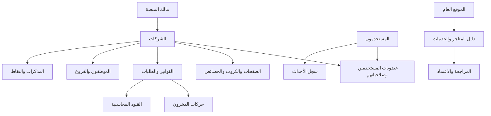

# خريطة النظام

## 1. تعريف المنتج

«تجارة» منصة أعمال متعددة الشركات. تجمع إدارة المستخدمين والطلبات والمنتجات والمخزون والمحاسبة والموظفين والمهام، وتتيح مساحة عامة قابلة للتوسع لدليل المتاجر والخدمات في اليمن. يجب أن تعمل المنصة بواجهات عربية RTL على الكمبيوتر والهاتف، وأن تكون خدماتها قابلة للاستهلاك من تطبيقات الهاتف مستقبلًا.

## 2. الطبقات الرئيسية

| الطبقة | مسؤوليتها |
|---|---|
| الهوية والوصول | الحسابات، جلسات الدخول، العضويات، الأدوار، الصلاحيات، ملف المستخدم |
| مساحة الشركة | الشركة النشطة، الإعدادات، المظهر، الترويسة، الفروع، إعدادات العمل |
| سجل الصفحات والخصائص | دليل الصفحات، الظهور، البحث والتقارير، خصائص الكروت والسجلات |
| العمليات التجارية | المنتجات، العملاء، الموردون، الفواتير، الطلبات، المذكرات |
| المخزون | الفروع والمخازن والمعرض والرفوف والتحويلات والتسويات وحركات الأصناف |
| المالية | دليل الحسابات، القيود، السندات، الأرصدة، العملات والتقارير |
| الموظفون | كرت الموظف والربط بالمستخدم والحسابات والفرع والدوام |
| التفاعل والتحفيز | الإشعارات والدردشة الداخلية والمذكرات والنقاط والمحفظة |
| الدليل العام | المتاجر والخدمات والمنتجات العامة والمراجعة والتعليقات والإعجابات والبحث |
| التدقيق والمنصة | سجل الأحداث، مراجعة المحتوى، إدارة المنصة من المالك |

## 3. العلاقة الأساسية بين البيانات

## 4. حدود الشركة

- المالك وحده ينشئ الشركات ويدير إعدادات المنصة العامة.
- الشركة الأولى هي مساحة الموقع الرئيسي، ويمكن تحديد أجزاء منها للعامة أو للعملاء.
- الموظف والعميل يدخلان الشركة عبر عضوية وصلاحيات واضحة.
- كل سجل تجاري أو مالي أو مخزني يخص شركة واحدة. يجب التحقق من company_id في كل قراءة وكتابة على الخادم.
- هوية المستخدم عامة، لكن تفضيلاته المهنية ومظهره للشركة يُحفظان لكل شركة على حدة.
- عند غياب الشركة من الرابط، تستعاد آخر شركة استخدمها العضو إذا كانت عضويته ما زالت فعالة؛ وإلا تُختار شركة متاحة أخرى.

## 5. دورة المستند

المستند التجاري يحتفظ برأس الفاتورة وتفاصيل الأصناف. الحفظ والترحيل يجب أن يكونا متسقين: إما ينجحان معًا أو يتراجعان معًا. ينشئ المستند حركات مخزون تفصيلية، ثم قيدًا محاسبيًا مجمعًا بحسب الحساب والعملة والأبعاد المطلوبة. يظل بالإمكان تتبع كل سطر قيد إلى الفاتورة ومصادره.

## 6. واجهات مستقبلية

- واجهة API موثقة ومستقلة عن الواجهة المرئية لتخدم موقع الويب وتطبيقات Android وiOS.
- إشعارات قابلة للتوسع إلى push notifications.
- دردشة داخلية وبريد داخلي مؤجلان إلى مرحلة لاحقة.
- أرشيف مستندات ومفكرة وتقويم.
- مساعد ذكاء اصطناعي يقدم اقتراحات اعتمادًا على بيانات مسموح للمستخدم برؤيتها فقط.
